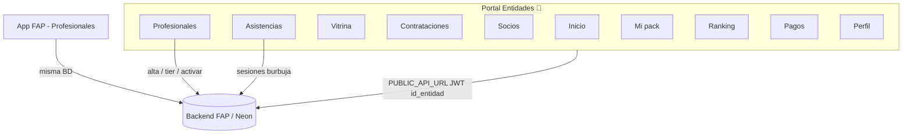

# 🏋️ Portal de Entidades — Fuerza y Acondicionamiento

<p align="center">
  
</p>

<p align="center">
  <strong>El centro de mando del gimnasio / centro.</strong><br/>
  Gestioná profesionales, tiers, vitrina, pagos, asistencias y el pack contratado — sin meterse en la app FAP del día a día del pro.
</p>

<p align="center">
  <a href="https://github.com/YourIdeasOurPlatform/fuerzayacondicionamiento-entidades"></a>
  
  
  
</p>

---

## 🎬 ¿Qué es esto?

| | |
|---|---|
| 🏢 **Quién lo usa** | Dueño / admin del **centro** (entidad) |
| 🎯 **Para qué** | Operar la burbuja del lugar: equipo, cupos, vitrina pública, cobros y planillas |
| 🔌 **API** | Misma backend FAP → `fuerzayacondicionamiento_backend` |
| 🚫 **Qué NO es** | No reemplaza FAP del profesional ni el admin de plataforma |

<p align="center">
  
</p>

> 💡 **En una frase:**  
> FAP = herramientas del profesional.  
> **Este portal** = tablero del **lugar** que los agrupa.

---

## 🧠 Reglas de negocio (importante)

### 1. Burbuja por entidad
- Cada profesional queda vinculado a un `id_entidad` (el centro).
- El portal **solo** ve y opera profesionales / socios / asistencias de **su** centro.
- No hay “mirar el gimnasio de al lado”.

### 2. Pack del centro = cupo + tiers permitidos
- El centro contrata un **pack** (`planes_entidad` / contratación de entidad).
- Ese pack define:
  - 👥 **Máximo de profesionales**
  - 🎚️ **Tiers SaaS** que se pueden asignar (Rookie, Challenger, etc.)
- Si el cupo está lleno → no se puede dar de alta otro pro.

### 3. Alta de profesional (desde el centro)
Flujo en modal stepper:

1. **Identidad** → nombre, apellido, DNI, mail  
2. **Contacto** → fecha, celular, género (opcionales)  
3. **Tier** → elegís el nivel incluido en el pack  

Al confirmar:

| Paso | Qué pasa |
|------|----------|
| ✅ Usuario | Se crea el profesional en la entidad |
| ✅ Suscripción | Contratación SaaS `active` con motivo `incluido_entidad` |
| ✅ Historial | Fila en pagos **validada** → arranca de inmediato |
| 🔑 Acceso | Password inicial = DNI *(no se muestra en la UI al centro)* |

<p align="center">
  
</p>

### 4. Activar / Desactivar ≠ Desvincular
| Acción | Efecto |
|--------|--------|
| 🟢 **Activar** | Cuenta usable en el centro |
| 🟠 **Desactivar** | Sigue en el equipo, pero **inactivo** (se puede reactivar) |
| 🚪 **Desvincular** | Sale de la burbuja del centro |

### 5. Vitrina
- El centro decide **quién aparece** en la vitrina pública.
- Por profesional: cards de planes de suscripción → **Mostrar / Ocultar card**.
- El perfil “bonito” (especialidad, etc.) lo termina el pro en FAP; sin perfil puede verse *Pendiente de alta*.

### 6. Pagos
- Historial del **pack del centro** + altas de profesionales (espejo en `pagos_cobranzas`).
- Declaración de pago del pack cuando aplica (transferencia / flujo pendiente de validación admin).

### 7. Asistencias
- Planillas de asistencia **de los profesionales del centro**.
- El lugar abre/cierra sesiones y marca presente / ausente / justificado.
- Scope siempre filtrado por burbuja (`id_entidad`).

### 8. Flags del backend
- Este front **no decide** flags de producto.
- Si el dominio entidades está apagado en el BE → el login puede responder **404**.
- Tipicamente requiere entidades (+ tiers) activos en el backend.

---

## 🗺️ Mapa del producto



### 📑 Secciones del menú

| Sección | Para qué sirve |
|---------|----------------|
| 🏠 **Inicio** | Pulso del centro: pack, cupo, preview de pros (máx. 5) + resumen por tier |
| 👥 **Profesionales** | Alta stepper, tiers, activar/desactivar, desvincular |
| 🪟 **Vitrina** | Visibilidad pública + cards de planes por pro |
| 📄 **Contrataciones** | Estado de vinculación / tier incluido |
| 🤝 **Socios** | Personas ligadas a los pros del centro |
| ✅ **Asistencias** | Planillas del equipo del lugar |
| 📦 **Mi pack** | Pack contratado y cupo |
| ⭐ **Ranking** | Promedio de calificaciones |
| 💳 **Pagos** | Datos de cobro + historial |
| 🪪 **Perfil** | Datos del centro / logo |

### 💬 FAB flotante (como FAP)
Abajo a la derecha:

- 🆘 **Ayuda** — dejar un mensaje  
- 🔔 **Notificaciones** — alertas del centro  
- 💬 **Chat** — soporte (demo local hoy; cablear a BE para prod)

---

## 🚀 Arranque local

### Requisitos
- Node **20+** (recomendado)
- Backend FAP corriendo (o modo demo)

### Install & run

```bash
npm install
npm run dev
```

🌐 App en **http://127.0.0.1:4322/**

### 🎭 Modo demo (sin backend)

```
http://127.0.0.1:4322/?demo=1
```

<p align="center">
  
</p>

Ideal para UI, demos a stakeholders y QA visual.  
Cuando **no** hay `?demo=1`, todas las llamadas van al API real.

### Build / preview

```bash
npm run build
npm run preview
```

### App de escritorio (Electron)

La misma app en una ventana de Linux, macOS o Windows. El backend sigue en la nube.

```bash
cd desktop-app
npm install
npm run dev      # con el front ya corriendo en :4322
npm run dist     # sync del front + instalador de este sistema
```

Pasos de sync, `.dmg`, `.exe` y AppImage: [`desktop-app/README.md`](./desktop-app/README.md).

---

## ⚙️ Configuración

| Variable | Descripción | Default |
|----------|-------------|---------|
| `PUBLIC_API_URL` | Base URL del backend FAP | `http://127.0.0.1:8000` |

Ejemplo `.env` (no se commitea):

```bash
PUBLIC_API_URL=https://tu-api.ejemplo.com
```

### CORS
Sumá el origen del portal a `CORS_ORIGINS` del backend, por ejemplo:

```
http://127.0.0.1:4322
https://tu-portal-entidades.onrender.com
```

---

## 🌿 Ramas (convención del equipo)

| Rama | Uso |
|------|-----|
| 🧪 **`features`** | Desarrollo diario · PRs · lo que se pushea ahora |
| 🔒 **`prod`** | Producción (protegida) · deploy Render |

```text
feature work  →  features  →  (PR / merge)  →  prod
```

> ⚠️ **No usamos `main`.**  
> De momento el trabajo vive en **`features`**.

---

## ☁️ Deploy

### GitHub Pages (demo estática) ✨

Cada push a **`features`** publica el sitio estático (modo demo automático en `*.github.io`).

| | |
|---|---|
| 🔗 **URL** | https://yourideasourplatform.github.io/fuerzayacondicionamiento-entidades/ |
| 🎭 **Demo** | Se activa sola en Pages (`?demo=0` la apaga) |
| ⚙️ **Workflow** | [`.github/workflows/deploy-pages.yml`](./.github/workflows/deploy-pages.yml) |

**Primera vez:** en el repo → **Settings → Pages → Source: GitHub Actions**.

<p align="center">
  
</p>

### Render (producción)

Archivo: [`render.yaml`](./render.yaml)

- Tipo: **Static Site**
- Build: `npm install && npm run build`
- Publish: `dist`
- Env: `PUBLIC_API_URL` (sync manual en el dashboard)
- Rama: **`prod`** (protegida)

---

## 🔌 API que consume (resumen)

Auth y burbuja bajo `/entidades/...` (JWT con cuenta entidad):

| Área | Ejemplos |
|------|----------|
| Auth / yo | `POST /entidades/auth/login` · `GET/PATCH /entidades/me` |
| Pack | `GET /entidades/me` · declarar pago · datos cobro · `GET /entidades/me/pagos` |
| Pros | `GET/POST /entidades/me/profesionales` · tier · activar · desactivar · desvincular |
| Vitrina | `GET /entidades/me/vitrina` · toggle pro/plan |
| Asistencias | `/entidades/me/asistencias/sesiones...` |
| Otros | socios · ranking · tiers permitidos |

Detalle fino → docs del backend (`docs/entidades-portal-plan.md`, `api-endpoints.md`).

---

## 🗂️ Estructura del repo

```text
fuerzayacondicionamiento-entidades/
├── public/                 # logos FAP + assets demo
├── src/
│   ├── components/
│   │   └── PortalApp.tsx   # shell + todas las vistas
│   ├── mock/
│   │   └── demoData.ts     # ?demo=1
│   ├── pages/
│   │   └── index.astro
│   └── styles/
│       └── portal.css      # tokens --fap-* (claro/oscuro)
├── desktop-app/            # shell Electron (sync del front + instalador)
├── render.yaml
├── package.json
└── README.md               # 👈 estás acá
```

Stack deliberadamente chico: **Astro + React**, una app, un CSS de sistema visual alineado a FAP.

---

## ✅ Checklist “¿está funcional de verdad?”

- [ ] Backend con dominio entidades (+ tiers) **ON**
- [ ] `PUBLIC_API_URL` apuntando al BE correcto
- [ ] CORS con el origen del portal
- [ ] Centro con pack activo y cupo
- [ ] Login **sin** `?demo=1`
- [ ] Alta pro → aparece en lista + pago validado
- [ ] Activar / desactivar / vitrina / asistencias OK
- [ ] FAB cableado a APIs reales (hoy es UI/demo)
- [ ] Deploy en `prod` + smoke test

<p align="center">
  
</p>

---

## 🎨 UX / look & feel

- Tokens CSS `--fap-*` (rojo FAP, tipografía UI, superficies)
- Tema **claro / oscuro** (toggle en topbar)
- Tablas ↔ cards según **ancho útil** del main (no solo viewport)
- Listados con paginado local; Inicio **no** lista 1000 pros (preview + “Ver todos”)

---

## 🤝 Repos hermanos

| Repo | Rol |
|------|-----|
| [`fuerzayacondicionamiento`](https://github.com/YourIdeasOurPlatform/fuerzayacondicionamiento) | Front FAP (pros / alumnos) |
| [`fuerzayacondicionamiento_backend`](https://github.com/YourIdeasOurPlatform/fuerzayacondicionamiento_backend) | API + Neon + dominio entidades |
| **este** | Portal del centro |

---

## 📜 Licencia / uso

Proyecto privado de **YourIdeasOurPlatform** / Fuerza y Acondicionamiento.  
Uso interno y de producto — no es un template genérico.

---

<p align="center">
  <strong>Hecho con ☕ + 💪 para que el centro vea claro su equipo.</strong><br/>
  <sub>power by ELJ</sub>
</p>

<p align="center">
  
</p>
